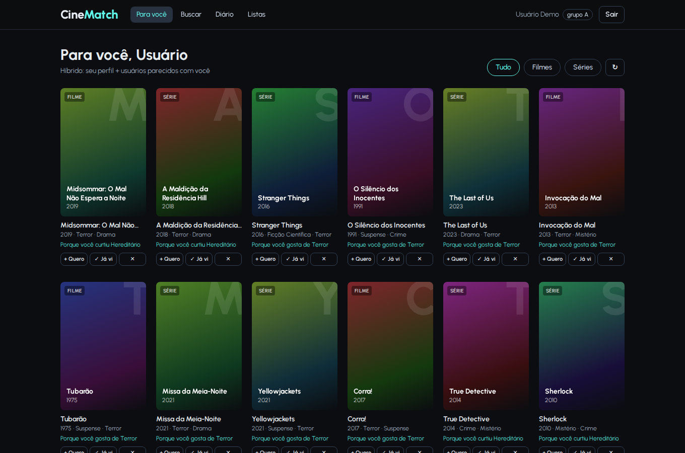
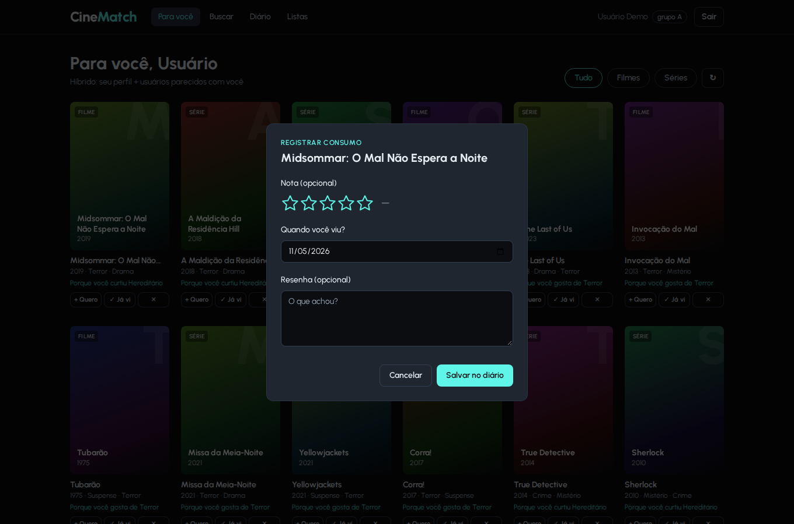
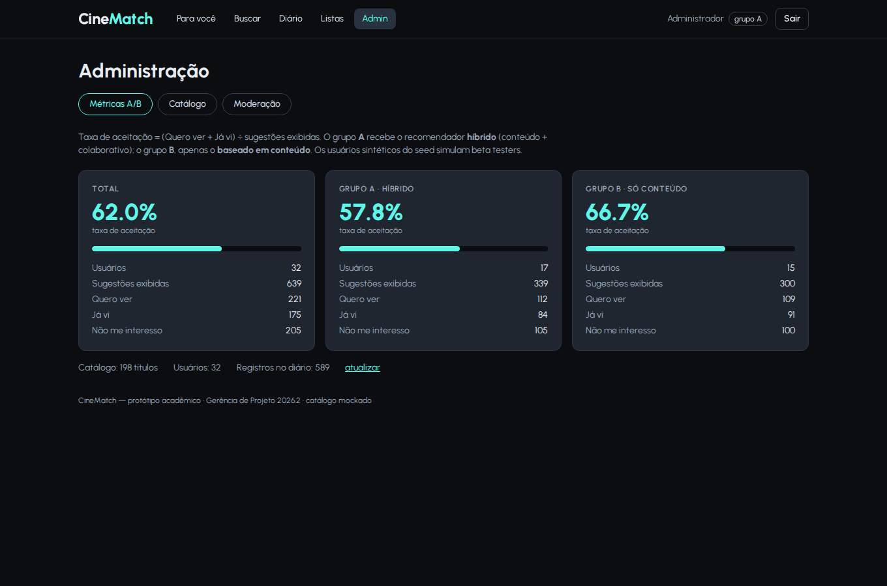

# CineMatch 🎬

> **A história do seu gosto** — diário de filmes e séries com motor de recomendação híbrido.
> Protótipo acadêmico da disciplina **Gerência de Projeto — 2026.2** (UFAL).



Plataformas de diário (como o Letterboxd) registram tudo o que você assiste, mas não usam esse acervo
para sugerir o próximo título. Netflix e Spotify recomendam, mas só dentro do próprio catálogo.
O CineMatch une as duas coisas: **um diário** + **um recomendador** que combina os atributos dos títulos
(gênero, tags, diretor, década) com o gosto de usuários parecidos com você.

---

## ✨ Funcionalidades (casos de uso do DCU)

| Pacote | Caso de uso | Onde está |
|---|---|---|
| Acesso | Cadastrar conta, Fazer login | Tela de login · `POST /auth/register`, `/auth/login` |
| Acesso | Definir preferências iniciais | Onboarding (gêneros + títulos que já gosta) · `PUT /me/preferences` |
| Uso Geral | Buscar mídias | Tela **Buscar** (título, diretor, tag, gênero, tipo) · `GET /media` |
| Uso Geral | Registrar consumo / Avaliar mídia | Botão **Já vi** (nota 0,5–5 ★ e resenha opcionais) · `/diary` |
| Uso Geral | Gerenciar listas | Tela **Listas** (watchlist "Quero ver" + listas próprias) · `/lists` |
| Uso Geral | Ver / Descartar recomendação | Feed **Para você** com *Quero ver · Já vi · Não me interesso* · `/recommendations` |
| Inteligência | Gerar recomendações | `app/services/recommender.py` (híbrido + cold start) |
| Administração | Gerenciar catálogo | Admin → Catálogo (criar, editar, excluir) · `/admin/media` |
| Administração | Sincronizar catálogo externo | Admin → Catálogo → **Sincronizar** (API externa mockada) · `POST /admin/sync` |
| Administração | Moderar avaliações | Admin → Moderação (ocultar/restaurar resenhas) · `/admin/reviews` |
| Métrica | Taxa de aceitação + teste A/B | Admin → Métricas A/B · `GET /admin/metrics` |

**Taxa de aceitação** = (Quero ver + Já vi) ÷ sugestões exibidas. Usuários do **grupo A** recebem o
recomendador **híbrido**; os do **grupo B**, só o **baseado em conteúdo**.

<p>
  
  
</p>

---

## 🚀 Como rodar (local)

Pré-requisitos: **Python 3.11+** e **Node.js 20+**.

### Opção 1 — script (Linux, macOS, WSL)

```bash
git clone https://github.com/joaolevi/cinematch.git
cd cinematch
./dev.sh            # instala dependências e sobe API + frontend
./dev.sh --reset    # mesmo, mas recria o banco com os dados de demonstração
```

> No Ubuntu/WSL, se der erro ao criar o venv: `sudo apt install python3-venv`.

### Opção 2 — manual (inclui Windows)

```bash
# Terminal 1 — backend
python -m venv .venv
# Linux/macOS: source .venv/bin/activate   |   Windows: .venv\Scripts\activate
pip install -r backend/requirements-dev.txt
cd backend
uvicorn app.main:app --reload            # http://localhost:8000/docs

# Terminal 2 — frontend
cd frontend
npm install
npm run dev                              # http://localhost:5173
```

Na primeira execução o banco SQLite (`backend/cinematch.db`) é criado e populado automaticamente.
Para recriar do zero: `cd backend && python -m scripts.seed`.

### Contas de demonstração

| Perfil | E-mail | Senha |
|---|---|---|
| Administrador | `admin@cinematch.dev` | `admin123` |
| Usuário (sem histórico, cai no *cold start*) | `demo@cinematch.dev` | `demo123` |
| 30 usuários sintéticos (personas de gosto) | `terror.1@seed.cinematch.dev` … `comedia.5@seed.cinematch.dev` | `senha123` |

---

## 🎤 Roteiro sugerido para a apresentação

1. Entre como **demo** → o feed mostra **"Em alta"** (tratamento de *cold start*: a tela nunca fica vazia).
2. Vá em **Definir preferências**: escolha *Terror*, marque *O Iluminado* e *Hereditário*.
3. Volte ao feed → agora as sugestões são personalizadas e explicadas ("Porque você curtiu Hereditário").
4. Clique **Já vi** em uma sugestão, dê 4,5 ★ e escreva uma resenha → ela aparece no **Diário**.
5. Clique **+ Quero** em outra → aparece em **Listas → Quero ver**. Clique **✕** em outra → some do feed para sempre.
6. Saia e entre como **admin** → **Métricas A/B** mostra a taxa de aceitação de cada grupo.
7. **Catálogo → Sincronizar**: importa ~45 títulos novos da "API externa".
8. **Moderação**: oculte a resenha escrita no passo 4 e mostre que ela some da página do título.
9. Mostre a documentação automática da API em http://localhost:8000/docs.

---

## 🧠 Como funciona o recomendador

Implementado em [`backend/app/services/recommender.py`](backend/app/services/recommender.py), segue o
Diagrama de Atividades do pitch:

1. **Consulta** histórico (diário, listas, descartes) e preferências do usuário.
2. **Sem dados → mídias em alta** (popularidade do catálogo + títulos mais registrados na plataforma).
3. **Com dados → híbrido:**
   - **Conteúdo:** cada título vira um vetor TF‑IDF de gêneros, tags, criadores, década e tipo. O perfil do
     usuário é a soma ponderada dos títulos com que interagiu (nota → `(nota − 2,5)/2,5`, watchlist `+0,5`,
     descarte `−0,7`, gêneros do onboarding `+1`). Score = similaridade de cosseno.
   - **Colaborativo (item‑item):** similaridade de cosseno entre títulos na matriz usuário × título —
     *"quem curtiu X também curtiu Y"*.
   - **Combinação:** `α·conteúdo + (1−α)·colaborativo + 0,1·popularidade`, com `α = 0,8` para quem tem
     pouco histórico e `0,5` depois. Grupo B usa `α = 1` (só conteúdo).
4. **Filtra** já registrados, descartados e itens da watchlist; aplica **diversidade** de gênero no topo.
5. **Explica** cada sugestão a partir do item do histórico que mais contribuiu.

O gosto atravessa tipos de mídia: o perfil é montado com filmes **e** séries, mesmo quando o feed é filtrado.

---

## 🏗️ Arquitetura

```
frontend/ (React + Vite + TypeScript + Tailwind)  ──REST/JSON + JWT──▶  backend/ (FastAPI)
                                                                         ├─ routers/   auth, media, diary, lists, recommendations, admin
                                                                         ├─ services/  recommender, catalog (CatalogProvider), metrics
                                                                         └─ SQLite via SQLAlchemy
```

- **Catálogo mockado:** `backend/data/seed_catalog.json` (153 títulos carregados no início) e
  `backend/data/mock_external_catalog.json` (45 títulos que o admin "sincroniza"). A interface
  `CatalogProvider` permite trocar o mock por uma integração real com o TMDB sem mexer no resto do sistema.
- **Pôsteres** são gerados no frontend a partir do título (não há imagens externas).

Mais detalhes no [plano do projeto](docs/PLANO.md).

```
cinematch/
├── backend/
│   ├── app/            # API: main, models, schemas, auth, crud, seed, routers/, services/
│   ├── data/           # catálogos mockados (JSON)
│   ├── scripts/seed.py # recria o banco
│   └── tests/          # pytest
├── frontend/src/       # pages/, components/, api.ts, auth.tsx, types.ts
├── docs/               # plano, pitch, screenshots
├── .claude/agents/     # agente do Claude Code especialista no projeto
└── dev.sh
```

---

## ✅ Testes

```bash
cd backend
python -m pytest -q        # 25 testes: acesso, diário, listas, feed, cold start, A/B, admin, métricas
cd ../frontend && npm run build   # checagem de tipos + build
```

O GitHub Actions roda os dois a cada push e pull request.

---

## 🤝 Como contribuir

Veja [CONTRIBUTING.md](CONTRIBUTING.md). Resumo: crie uma branch a partir da `main`, faça commits
pequenos, abra um Pull Request vinculado à issue (`Closes #N`) e espere o CI ficar verde.

## 🗺️ Próximos incrementos

- **Álbuns** (MusicBrainz) como terceira mídia — previsto no pitch para o segundo incremento.
- Integração real com o **TMDB** (pôsteres, sinopses e catálogo completo) via um novo `CatalogProvider`.
- Deploy em nuvem.

## 👥 Equipe

Antônio Carlos Freitas Lopes · Bárbara Rocha de Albuquerque · João Levi Gomes de Lima ·
Karla Sophia Santana da Cruz · Lara Nogueira · Vinicius Cortez

Licença [MIT](LICENSE).
