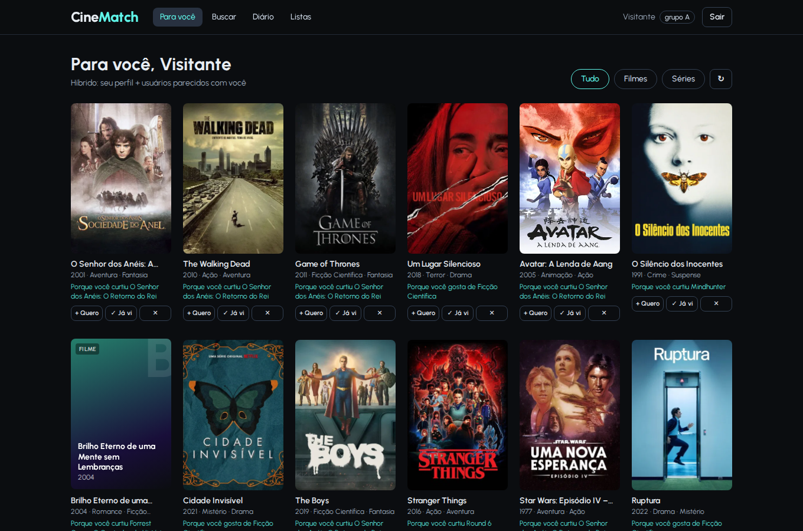

# Tastory 🎬

> **A história do seu gosto**: diário de filmes e séries com motor de recomendação híbrido.
> Protótipo acadêmico da disciplina **Gerência de Projeto, 2026.2** (UFAL).

Plataformas de diário (como o Letterboxd) registram tudo o que você assiste, mas não usam esse acervo
para sugerir o próximo título. Netflix e Spotify recomendam, mas só dentro do próprio catálogo.
O Tastory une as duas coisas: **um diário** + **um recomendador** que combina os atributos dos títulos
(gênero, tags, diretor, década) com o gosto de usuários parecidos com você.

Este repositório tem a **API (backend)**, com integração real com o **TMDB**. O frontend oficial está a
cargo de outro integrante e consome esta API. O guia para ele está em [`docs/API.md`](docs/API.md).
Em [`demo-front/`](demo-front/) há um **protótipo de interface só para apresentação**:

```bash
./demo.sh --reset    # recria o banco (mock + TMDB) e sobe API + interface → http://localhost:5173
```



---

## ✨ Funcionalidades (casos de uso do DCU)

| Pacote | Caso de uso | Rotas |
|---|---|---|
| Acesso | Cadastrar conta, Fazer login | `POST /auth/register`, `POST /auth/login` |
| Acesso | Definir preferências iniciais | `PUT /me/preferences` |
| Uso Geral | Buscar mídias | `GET /media`, `GET /media/{id}` |
| Uso Geral | Registrar consumo / Avaliar mídia | `/diary` (nota 0,5–5 ★ e resenha opcionais) |
| Uso Geral | Gerenciar listas | `/lists` (watchlist "Quero ver" + listas próprias) |
| Uso Geral | Ver / Descartar recomendação | `GET /recommendations`, `POST /recommendations/{id}/feedback` |
| Inteligência | Gerar recomendações | `app/services/recommender.py` (híbrido + cold start) |
| Administração | Gerenciar catálogo | `/admin/media` |
| Administração | Sincronizar catálogo externo | `POST /admin/sync`, `/admin/tmdb/search`, `/admin/tmdb/import` |
| Administração | Moderar avaliações | `/admin/reviews` |
| Métrica | Taxa de aceitação + teste A/B | `GET /admin/metrics` |

**Taxa de aceitação** = (Quero ver + Já vi) ÷ sugestões exibidas. Usuários do **grupo A** recebem o
recomendador **híbrido**; os do **grupo B**, só o **baseado em conteúdo**.

---

## 🚀 Como rodar (local)

Pré-requisito: **Python 3.11+**.

```bash
git clone https://github.com/joaolevi/cinematch.git
cd cinematch
cp .env.example .env     # opcional: coloque sua chave do TMDB em TASTORY_TMDB_API_KEY
./dev.sh                 # instala dependências e sobe a API em http://localhost:8000/docs
./dev.sh --reset         # mesmo, mas recria o banco com os dados de demonstração
```

> No Ubuntu/WSL, se der erro ao criar o venv: `sudo apt install python3-venv`.

**Windows / manual:**

```bash
python -m venv .venv
.venv\Scripts\activate            # Linux/macOS: source .venv/bin/activate
pip install -r backend/requirements-dev.txt
cd backend
uvicorn app.main:app --reload
```

Na primeira execução o banco SQLite (`backend/tastory.db`) é criado e populado automaticamente com
o catálogo mockado. Para recriar do zero: `cd backend && python -m scripts.seed`.

### Com Docker

Sobe a API, a interface e o PostgreSQL com um comando. Pré-requisito: Docker.

```bash
docker compose up --build    # API em :8000 e interface em :5173
docker compose down          # para tudo e mantém os dados
docker compose down -v       # para tudo e apaga o banco
```

Se o `.env` tiver `TASTORY_TMDB_API_KEY`, o Docker usa essa chave.

### Contas de demonstração

Essas senhas valem só para uso local. Em produção, elas são recusadas (veja `docs/DEPLOY.md`).

| Perfil | E-mail | Senha |
|---|---|---|
| Administrador | `admin@tastory.dev` | `admin123` |
| Usuário (sem histórico, cai no *cold start*) | `demo@tastory.dev` | `demo123` |
| 30 usuários sintéticos (personas de gosto) | `terror.1@seed.tastory.dev` … `comedia.5@seed.tastory.dev` | `senha123` |

---

## 🎞️ Catálogo: mock + TMDB

- **Mock (offline):** `backend/data/seed_catalog.json` (153 títulos carregados no início) e
  `mock_external_catalog.json` (45 extras). Funciona sem internet e sem chave.
- **TMDB (real):** com `TASTORY_TMDB_API_KEY` no `.env`, o admin pode:
  - `POST /admin/sync?provider=tmdb&pages=2`: importa filmes e séries populares no Brasil, com
    pôster, sinopse em português, diretor/criadores e palavras-chave;
  - `GET /admin/tmdb/search?q=...` + `POST /admin/tmdb/import`: busca e importa um título específico;
  - `POST /admin/tmdb/enrich`: procura no TMDB os títulos do mock e completa com pôster e sinopse
    oficiais (145 de 147 encontrados), mantendo tags e diretores.
- `python -m scripts.seed --tmdb` recria o banco já com os populares do TMDB e o mock enriquecido.
- Os gêneros do TMDB são convertidos para o mesmo vocabulário do mock, e um título que já existe
  no mock (mesmo tipo, título e ano) é **atualizado com os dados do TMDB em vez de duplicado**.
- Tudo passa pela interface `CatalogProvider` (`services/catalog.py`, `services/tmdb.py`).

### Como obter a chave do TMDB

É grátis para uso não comercial, desde que o TMDB seja creditado, e a interface já mostra esse crédito.

1. Crie uma conta em [themoviedb.org](https://www.themoviedb.org/signup) e confirme o e-mail.
2. No computador, abra [Configurações > API](https://www.themoviedb.org/settings/api), solicite a chave e aceite os termos.
3. Copie o **API Read Access Token**, o código longo que começa com `eyJ`. A API Key também funciona.
4. Rode `cp .env.example .env` e preencha `TASTORY_TMDB_API_KEY=` no `.env`.
5. Para confirmar, rode `cd backend && python -m pytest -q -m integration`.

> 🔐 A chave do TMDB fica **só no `.env`**, que está no `.gitignore`. Nunca a coloque no código.

---

## 🧠 Como funciona o recomendador

Implementado em [`backend/app/services/recommender.py`](backend/app/services/recommender.py), segue o
Diagrama de Atividades do pitch:

1. **Consulta** histórico (diário, listas, descartes) e preferências do usuário.
2. **Sem dados → mídias em alta** (popularidade do catálogo + títulos mais registrados na plataforma).
3. **Com dados → híbrido:**
   - **Conteúdo:** cada título vira um vetor TF‑IDF de gêneros, tags, criadores, década e tipo. O perfil do
     usuário é a soma ponderada dos títulos com que interagiu (nota → `(nota − 2,5)/2,5`, watchlist `+0,5`,
     descarte `−0,7`, gêneros do onboarding `+1`). O score é a similaridade de cosseno.
   - **Colaborativo (item‑item):** similaridade de cosseno entre títulos na matriz usuário × título, ou seja,
     *"quem curtiu X também curtiu Y"*.
   - **Combinação:** `α·conteúdo + (1−α)·colaborativo + 0,1·popularidade`, com `α = 0,8` para quem tem
     pouco histórico e `0,5` depois. O grupo B usa `α = 1` (só conteúdo).
4. **Filtra** já registrados, descartados e itens da watchlist; aplica **diversidade** de gênero no topo.
5. **Explica** cada sugestão a partir do item do histórico que mais contribuiu.

---

## ✅ Testes

```bash
cd backend
python -m pytest -q                    # todos (65)
python -m pytest -q -m "not integration"   # só offline (52): é o que roda no CI
python -m pytest -q -m integration     # só integração real com TMDB + banco (13, precisa da chave)
```

- **Offline:** acesso, diário, listas, feed, cold start, A/B, admin, métricas e o provider do TMDB com
  respostas simuladas (`httpx.MockTransport`).
- **Integração** (`tests/integration/`): chamam a API real do TMDB e verificam normalização em português,
  sincronização persistida no banco, idempotência, deduplicação com o mock, busca/importação,
  enriquecimento do mock e o recomendador usando títulos do TMDB. São puladas automaticamente se não houver chave.

---

## 🏗️ Estrutura

```
cinematch/
├── backend/
│   ├── app/            # main, models, schemas, auth, crud, seed, routers/, services/ (recommender, catalog, tmdb, metrics)
│   ├── data/           # catálogos mockados (JSON)
│   ├── scripts/seed.py # recria o banco
│   └── tests/          # pytest (+ integration/ com o TMDB real)
├── demo-front/         # protótipo de interface para apresentação (não é o front oficial)
├── demo.sh             # sobe API + demo-front
├── docs/               # PLANO.md, API.md, openapi.json, pitch
├── .claude/agents/     # agente do Claude Code especialista no projeto
└── dev.sh
```

## 🤝 Como contribuir

Veja [CONTRIBUTING.md](CONTRIBUTING.md). Resumo: crie uma branch a partir da `homol`, faça commits
pequenos, abra um Pull Request vinculado à issue (`Closes #N`) e espere o CI ficar verde.

## 🗺️ Próximos incrementos

- **Frontend oficial** consumindo esta API (guia em `docs/API.md`).
- **Álbuns** (MusicBrainz) como terceira mídia, previsto no pitch para o segundo incremento.
- Deploy em nuvem.

## 👥 Equipe

Antônio Carlos Freitas Lopes · Bárbara Rocha de Albuquerque · João Levi Gomes de Lima ·
Karla Sophia Santana da Cruz · Lara Nogueira · Vinicius Cortez

Licença [MIT](LICENSE).
