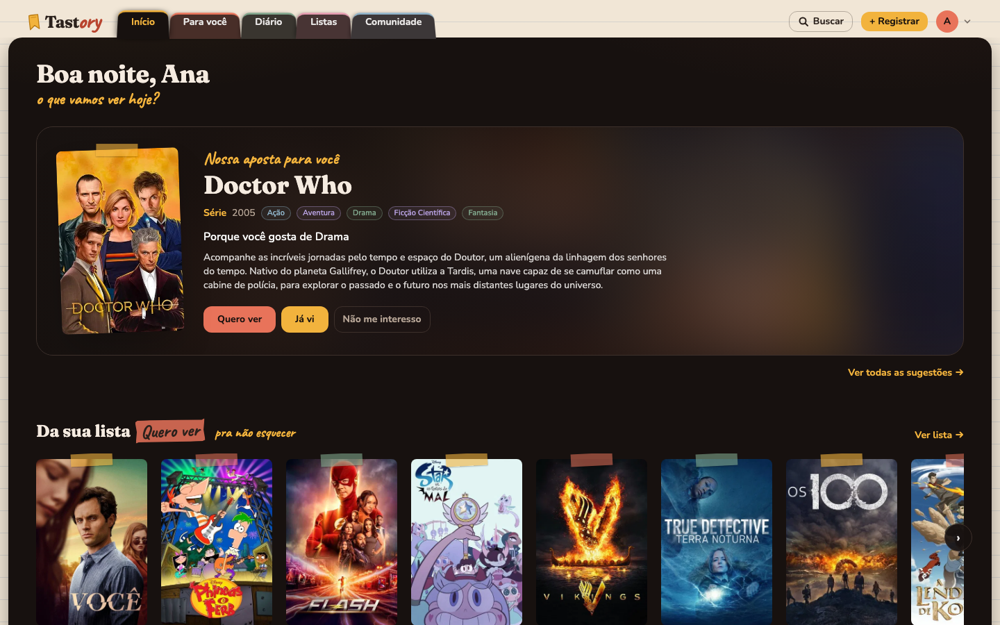
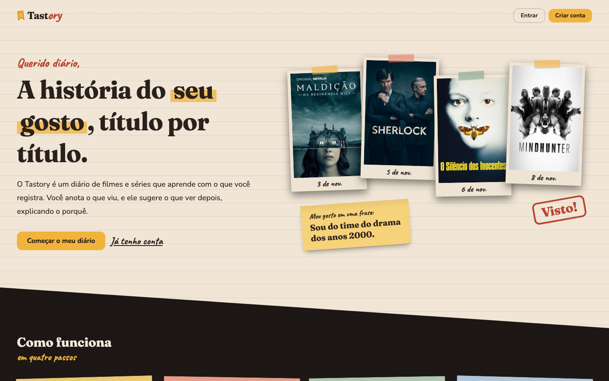
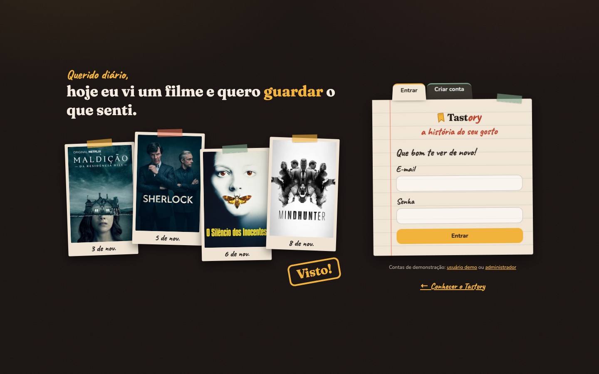
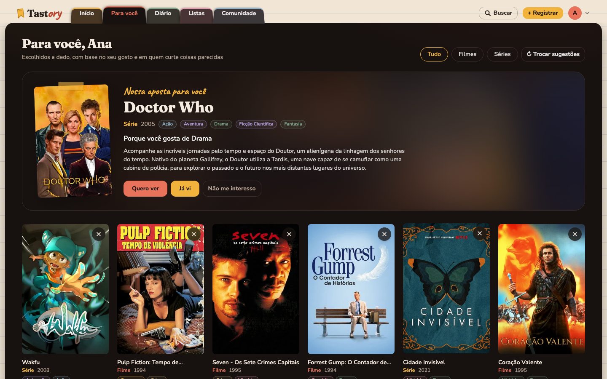
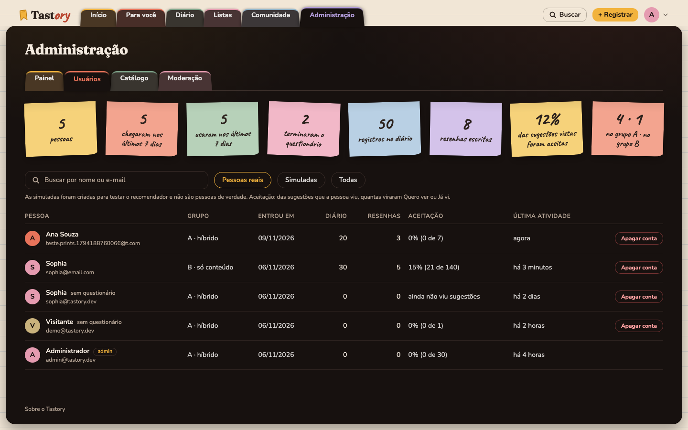
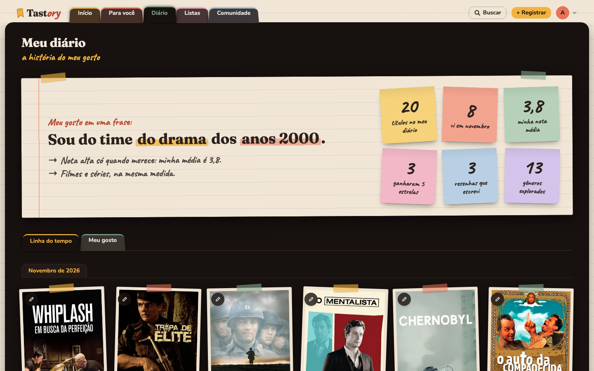
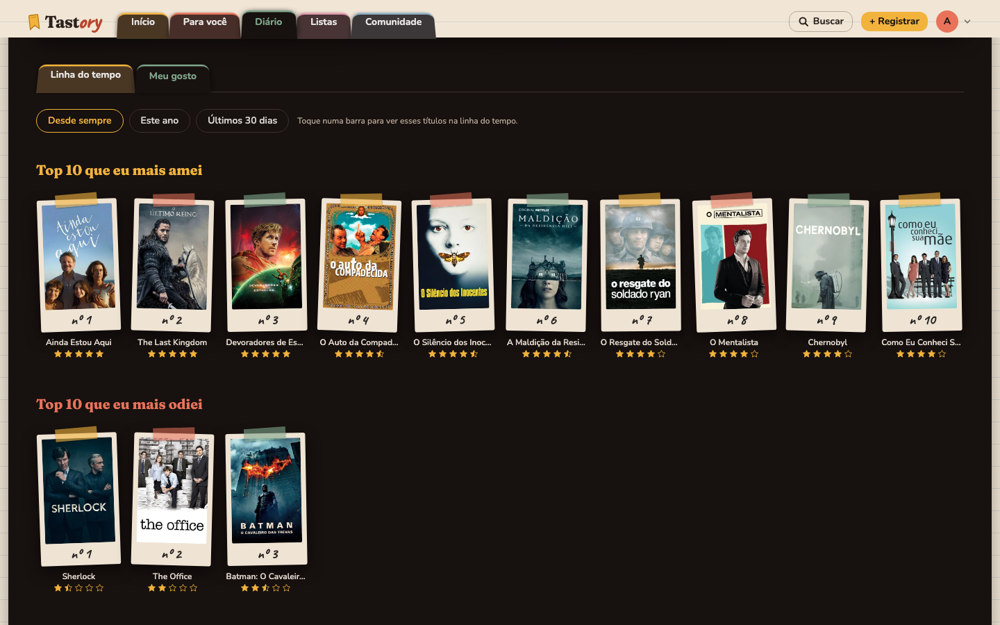
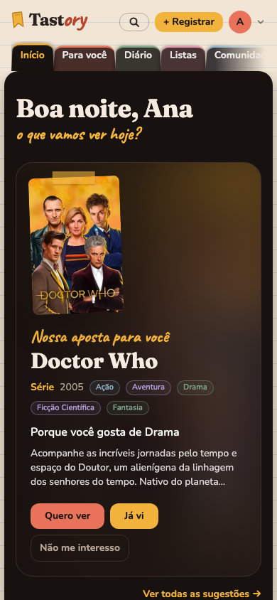
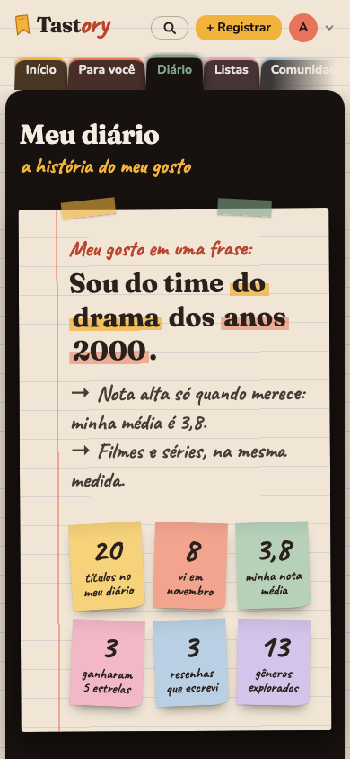

# frontend: interface do Tastory

> Responsável: Lara. A interface consome a API pelo contrato em [`../docs/tecnico/API.md`](../docs/tecnico/API.md).

React + Vite + TypeScript + Tailwind. Telas:

- **Antes de entrar:** apresentação (`/bem-vindo`) e login ou cadastro (`/login`).
- **Depois de entrar:** Início, Para você (feed), Diário (abas Linha do tempo e Meu gosto), Listas, Comunidade,
  Busca, detalhe do título, Sobre e o questionário inicial em três passos.
- **Administração:** Painel (taxa de aceitação e teste A/B), Usuários, Catálogo (com sincronização e importação do
  TMDB) e Moderação.
- **Em qualquer tela:** o botão **+ Registrar**, que registra no diário algo visto fora do feed, e o menu da
  pessoa (avatar), com atalhos e **Sair**.



## Rodar

Na raiz do repositório:

```bash
./demo.sh --reset   # 1ª vez: recria o banco com mock + populares do TMDB e sobe tudo
./demo.sh           # nas próximas
```

Ou manualmente: suba a API (`./dev.sh`) e, em outro terminal, `cd frontend && npm install && npm run dev`.
Abra http://localhost:5173.

## Roteiro da demo (≈ 7 min)

1. Abra http://localhost:5173. Quem não entrou vê a **apresentação**: o que é o Tastory, como funciona em quatro
   passos e o aviso de que os registros aparecem na Comunidade.
2. Clique em **Já tenho conta** e entre como **demo** (`demo@tastory.dev` / `demo123`). Essa conta começa no
   **questionário**, com três passos: gêneros, épocas e diretores, e títulos já vistos. Os títulos marcados viram
   polaroides.
3. Clique em **Pular por enquanto**. O feed mostra **"Em alta agora"**: é o *cold start*, a tela nunca fica vazia.
   Clique em **Definir preferências**, escolha 1–2 gêneros e marque 3–4 títulos. As sugestões agora são
   personalizadas e **explicadas** ("Porque você curtiu …").
4. No **Para você**:
   - **Já vi** em uma sugestão → dê estrelas e escreva uma resenha. O carimbo **Visto!** confirma.
   - **Quero ver** → o título vai para **Listas → Quero ver**.
   - O **✕** no canto do pôster é o **Não me interesso**: tira o título do feed, e o aviso oferece **Desfazer**.
   - **Ver mais sugestões**, no fim da página, traz mais títulos, e **↻ Trocar sugestões** recomeça. Um card só conta
     como exibido depois de 1 segundo na tela.
5. Abra o **Diário**:
   - no topo, a frase do gosto ("Sou do time do drama dos anos 2000") e os números em post-its;
   - na **Linha do tempo**, cada título é uma polaroide com a data escrita à mão;
   - em **Meu gosto**, o top 10 dos mais amados e dos mais odiados e os gráficos, por período. Clicar numa barra
     mostra esses títulos na linha do tempo.
6. Use o **+ Registrar**, no topo: busque um título que viu fora do feed e salve. Ele não conta na taxa de
   aceitação, porque não veio de uma sugestão.
7. Volte ao **Início**: a aposta do dia, a lista Quero ver, o que está em alta, um pedaço do diário e a
   **Comunidade**. Na Busca, o que já está no diário aparece com o selo **Visto**. No detalhe de um título, gêneros,
   diretores e atores levam à Busca filtrada, e **Títulos parecidos** sugere o que ver depois.
8. Pelo avatar, clique em **Sair** e entre como **admin** (`admin@tastory.dev` / `admin123`):
   - **Administração → Painel**: a taxa de aceitação em frases ("De cada 100 sugestões, 53 viraram Quero ver ou
     Já vi") e a comparação entre o grupo A (híbrido) e o B (só conteúdo);
   - **Usuários**: quem usa o sistema, o que cada pessoa fez e a opção de apagar uma conta;
   - **Catálogo → Buscar no TMDB**: procure um filme (ex.: *O Agente Secreto*) e clique **+ Importar**;
   - **Moderação**: oculte a resenha do passo 4.
9. Mostre a documentação da API em http://localhost:8000/docs.

Dica: rode `./demo.sh --reset` antes da call para começar com dados limpos.

| Apresentação | Login |
|---|---|
|  |  |
| **Para você** | **Administração → Usuários** |
|  |  |

## Identidade visual: "diário aconchegante"

O Tastory é um diário, não um cinema. A identidade lembra um caderno à luz de abajur: papel pautado, fundo marrom
bem escuro, cores quentes e detalhes de papelaria (fita adesiva, polaroides, post-its, letra à mão, carimbo, abas de
fichário). Nada nela é exclusivo de filmes, porque as músicas entram no incremento 2.





### A regra que segura tudo

**Papel para o que é pessoal ou onde se escreve; fundo escuro para o conteúdo.**

- **Moldura:** dentro do sistema, o cabeçalho e as margens são uma folha pautada, e a página escura fica dentro dela,
  como uma pasta. As abas do menu saem da página.
- **Papel:** a frase do gosto, as janelas do **Já vi** e do **+ Registrar**, o menu da pessoa, o questionário
  inicial, o login, a página Sobre e os resumos da Administração.
- **Polaroide só para o que a pessoa viu.** Cada título visto é uma lembrança, com a data escrita à mão. O que ela
  **quer ver** é um pôster preso com fita, sem data. Sugestões, busca e catálogo usam pôster limpo.
- **Apresentação:** começa na folha de papel e termina num corte em diagonal para o fundo escuro.

As telas usam a largura toda, até 1680 px. A grade de pôsteres é uma só, `MEDIA_GRID` em `src/ui.ts`: de 2 colunas
no celular a 7 em telas grandes.

### Cores

Os tokens ficam em `src/index.css`, no bloco `@theme`, e viram classes do Tailwind (`bg-coral`, `text-sage`...).

| Token | Cor | Uso |
|---|---|---|
| `bg` | `#17110f` | Fundo da página e texto sobre botões coloridos |
| `surface`, `surface-2` | `#231a17`, `#2e2320` | Cards e campos |
| `line` | `#3d302b` | Bordas e divisórias |
| `cream` | `#f5ebe0` | Texto principal no escuro |
| `muted` | `#b5a495` | Texto de apoio |
| `accent` (= `amber`) | `#f2b33d` | Marca, destaque, botão **Já vi**, **Séries** |
| `coral` | `#e8735a` | Botão **Quero ver**, **Filmes**, a etiqueta da lista Quero ver |
| `sage` | `#7fa58b` | Terceiro destaque; vai ser a cor dos **álbuns** |
| papel | `#f1e6d6` | Folhas pautadas; a tinta é `#2b211c` e a tinta vermelha, `#b9452f` |

Regras:

- Cada tipo de mídia tem uma cor fixa, em `MEDIA_STYLE` (`src/format.ts`): filme coral, série âmbar.
- Cada gênero tem uma cor fixa, calculada pelo nome (`colorFor` em `src/format.ts`). Use o `GenreChip`.
- Cada aba de fichário tem a sua cor, pela posição (`tabColor` em `src/ui.ts`).
- Nos gráficos, só a maior barra ganha cor; as outras ficam em `#76655b`. As cores foram testadas para
  daltonismo e contraste contra o fundo dos cards.
- Texto vai em `cream`, `muted` ou nos tons `stone-*` do Tailwind. Não use `slate-*`, que é frio.

### Fontes

- **Fraunces** (serifada, arredondada) nos títulos `h1`, no "Tast" do logo e nos números grandes: `font-display`.
- **Caveat** (letra à mão) só no que é anotação pessoal: o "ory" do logo, legendas das polaroides, post-its,
  resenhas, recados de telas vazias e frases curtas como "a história do meu gosto": `font-hand`.
- **Nunito** no resto. As três vêm do Google Fonts, carregadas em `index.html`.

O logo junta as duas primeiras: "Tast" impresso e "ory" escrito à mão, com a mesma altura de letra e a mesma linha
de base. O gosto vira uma história que a pessoa escreve. Sobre fundo escuro, o "ory" fica num recorte de papel.

### Elementos

| Elemento | Onde | No código |
|---|---|---|
| Marcador de página desenhado à mão | Logo, favicon e prévia do link | `Logo` em `Layout.tsx`, `public/og.jpg` |
| Abas de fichário coloridas | Menu, Listas, abas do diário, Administração, login | classe `.nb-tab`, `tabColor` |
| Folha pautada com margem | Frase do gosto, janelas, login, Sobre, resumos | classes `.paper`, `.marker`, `.ruled` |
| Polaroide com fita e legenda à mão | O que a pessoa viu, em todas as telas | `Polaroid`, `polaroid` no `MediaCard` |
| Pôster preso com fita | O que a pessoa quer ver | `pinned` no `MediaCard` |
| Post-its | Números do diário e da aba Usuários, "Como funciona", avisos | classes `.postit`, `.toast-note`, `Toast` |
| Fitas coloridas para escolher | Questionário inicial | classe `.tape-chip` |
| Etiqueta da lista Quero ver | Quando o nome da lista aparece no meio de uma frase | `ListName` |
| Selo **Visto** e carimbo **Visto!** | Busca e listas; ao registrar um título | `sticker` no `MediaCard`, `SeenStamp` |
| Recados à mão | Telas vazias e de espera | `HandNote` |
| Textura de grão | Fundo de todas as telas | `body::before` em `index.css` |

**Gráficos vivos.** As barras crescem ao abrir a aba e deslizam quando o período muda. Clicar em uma barra mostra
esses títulos na linha do tempo.

**Botões de fechar e tirar** ficam sempre no canto superior direito: o X das janelas, o **Não me interesso** nos
pôsteres do feed e o tirar da lista.

### Textos

- O diário fala na primeira pessoa, como quem escreve nele: "Sou do time do drama", "minha nota média", "Top 10
  que eu mais amei", "Querido diário, eu vi:". As outras telas falam com a pessoa ("Para você", "Você viu em...").
- Botões dizem a ação ("Editar registro"); o status fica em outro texto ("Você viu em 06/11/2026"). Não junte
  os dois com traço.
- Use o plural certo com `plural()`, nunca "título(s)".
- Nada de termos técnicos ou em inglês na tela: "Administração", não "Admin"; "Catálogo de exemplo", não "Mock".
- Telas vazias e de espera usam um recado à mão (`HandNote`), não texto cinza solto.
- Cada página define o nome da aba do navegador com `usePageTitle`, por exemplo "Meu diário | Tastory".

### Celular

| Início | Diário |
|---|---|
|  |  |

No celular, as abas do menu ficam numa linha que rola para o lado, e o cabeçalho mostra só o logo, a lupa, o
**+ Registrar** e o avatar.

### Prévia do link

`index.html` tem as tags `og:*` usadas pelo WhatsApp e afins. A imagem precisa de endereço completo: no build de
produção, `VITE_PUBLIC_URL` recebe o `TASTORY_PUBLIC_URL` do `.env.production`.
